# Minuta

Minuta is a small Markdown editor with two native versions: one for
Windows 98 and one for Haiku. It shows one column of monospaced text, keeps
the Markdown syntax on screen in a lighter gray, and has a focus mode,
typewriter scrolling, a night theme and a full screen mode for writing
without distractions. It comes with `md2html`, a converter for the Win32
console and for DOS.

Both versions share the same Markdown code (`src/core` and
[md4c](https://github.com/mity/md4c)); each has its own user interface
written for its system.

## Windows 98

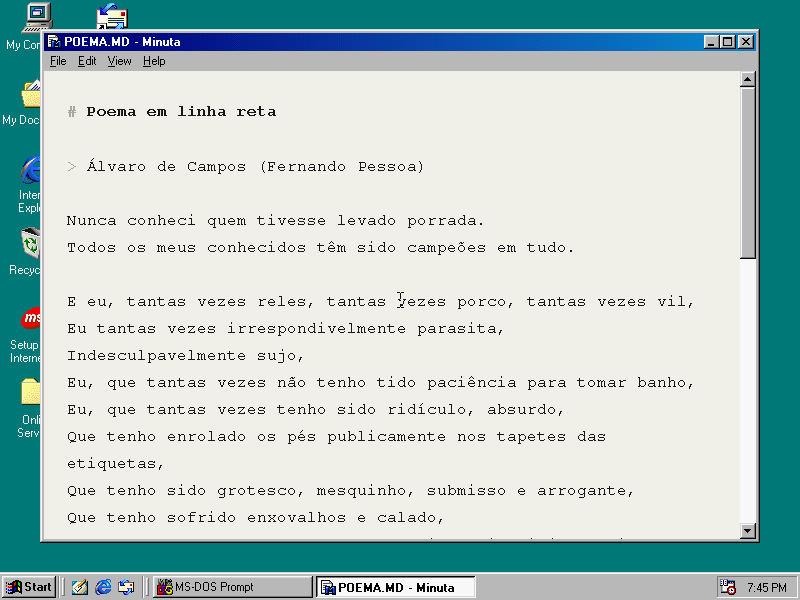

| | |
|---|---|
| 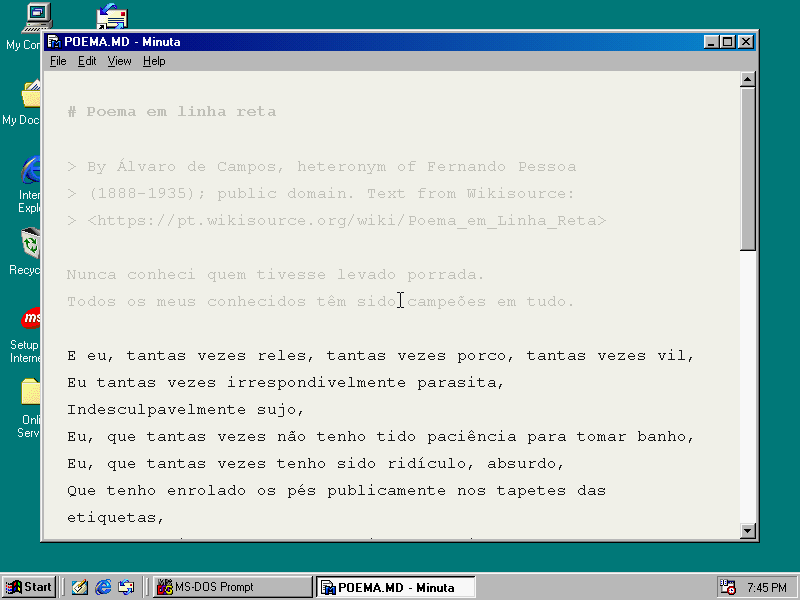 | 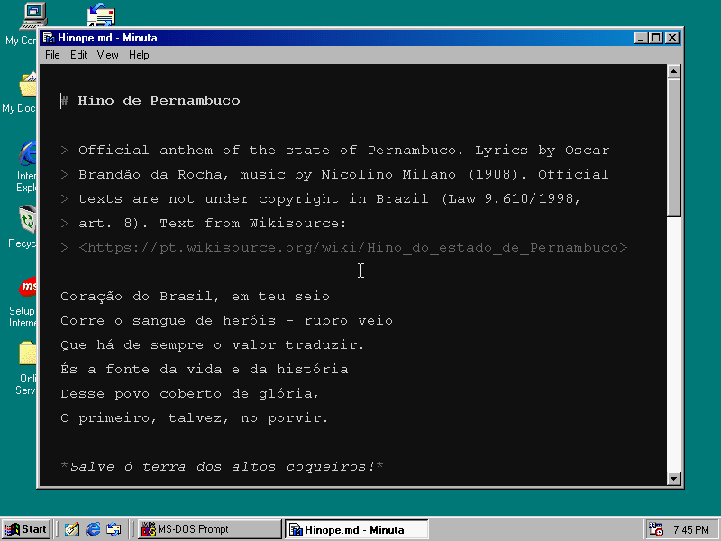 |
| 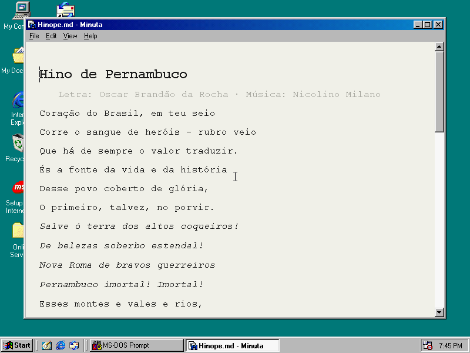 | 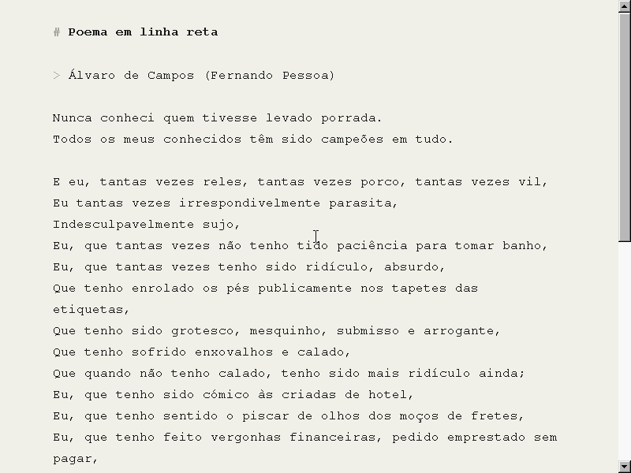 |

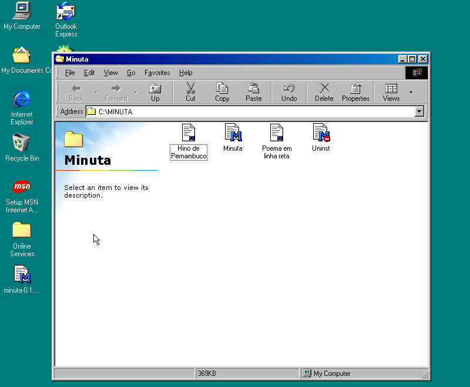

## Haiku

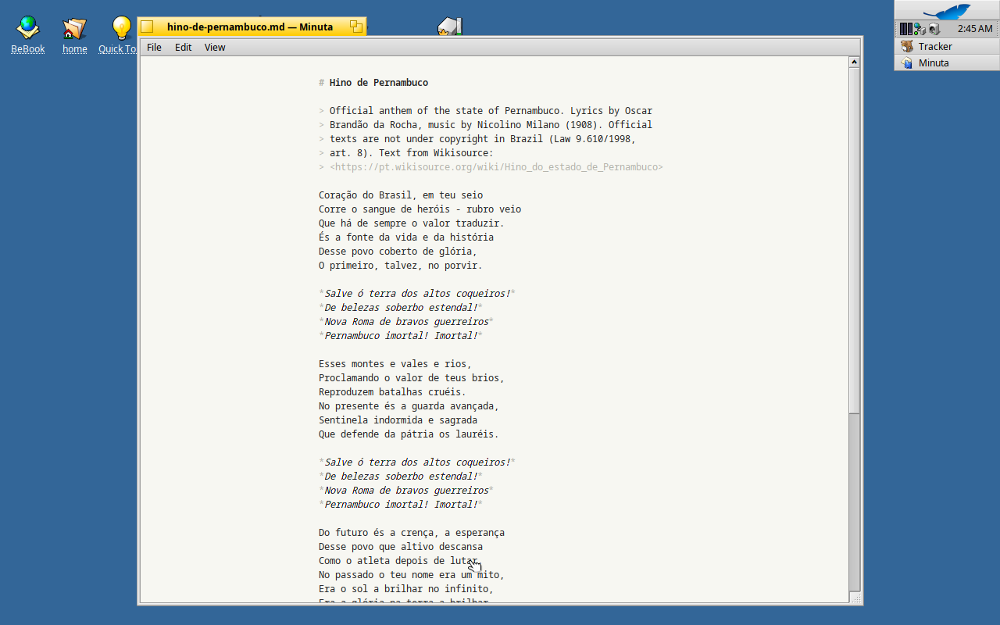

| | |
|---|---|
| 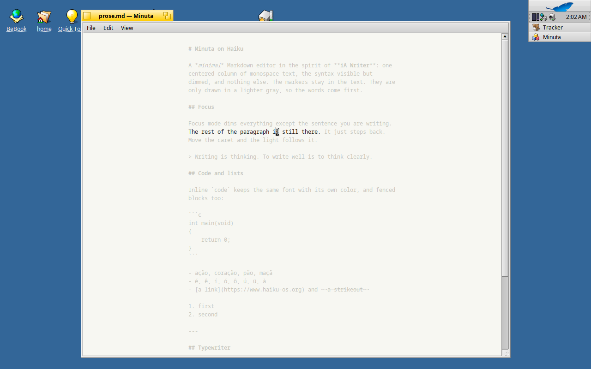 | 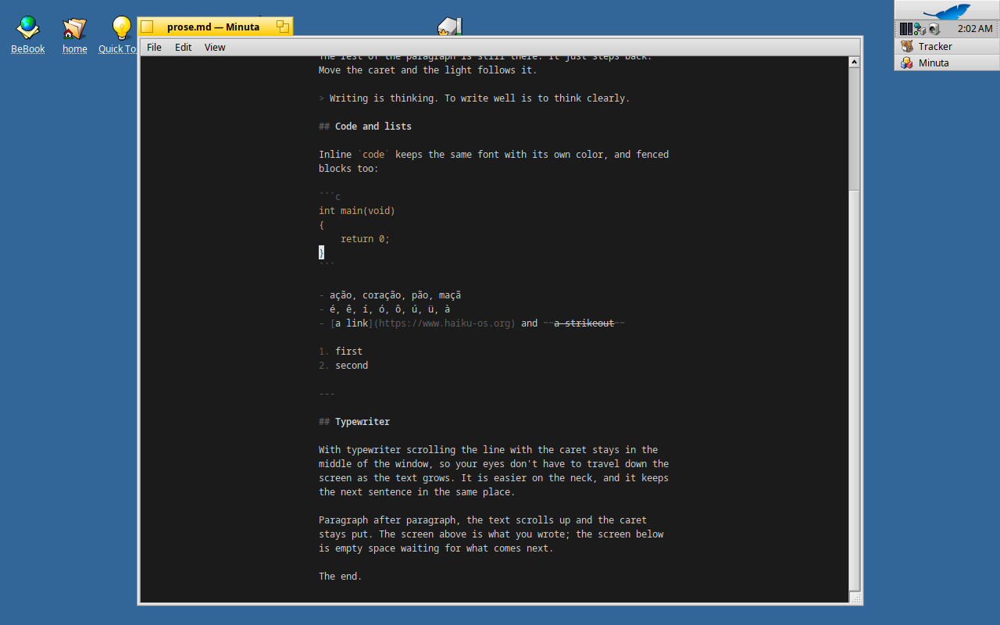 |
| 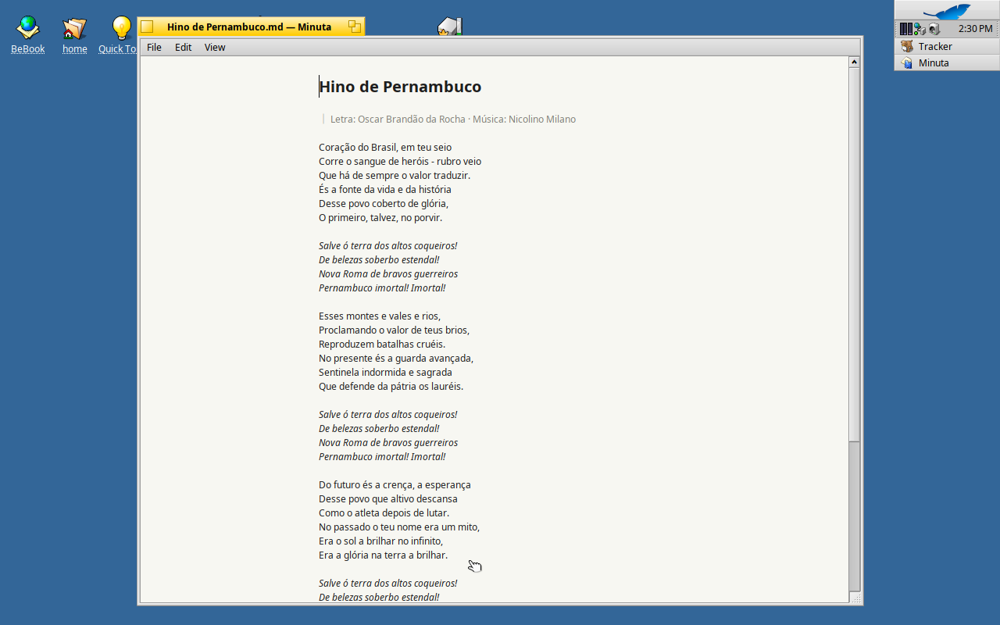 | 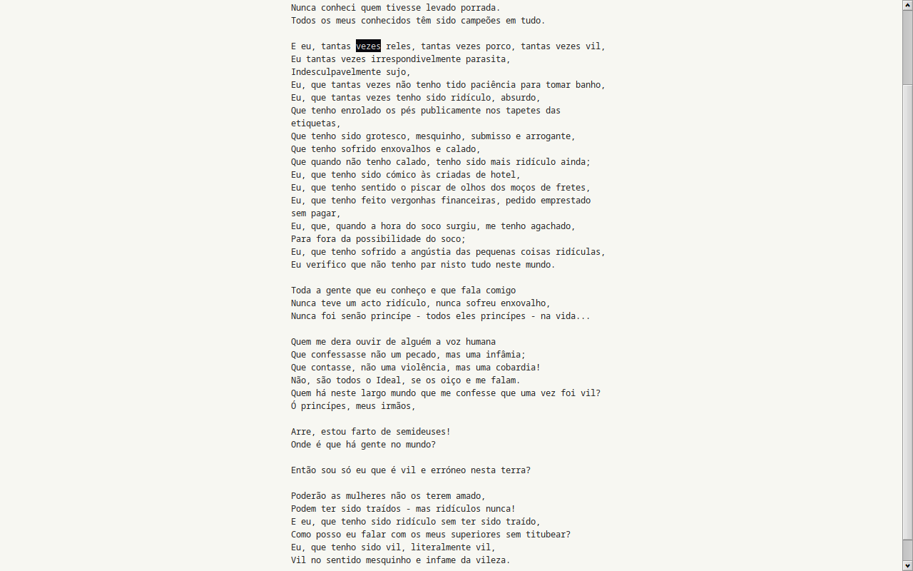 |

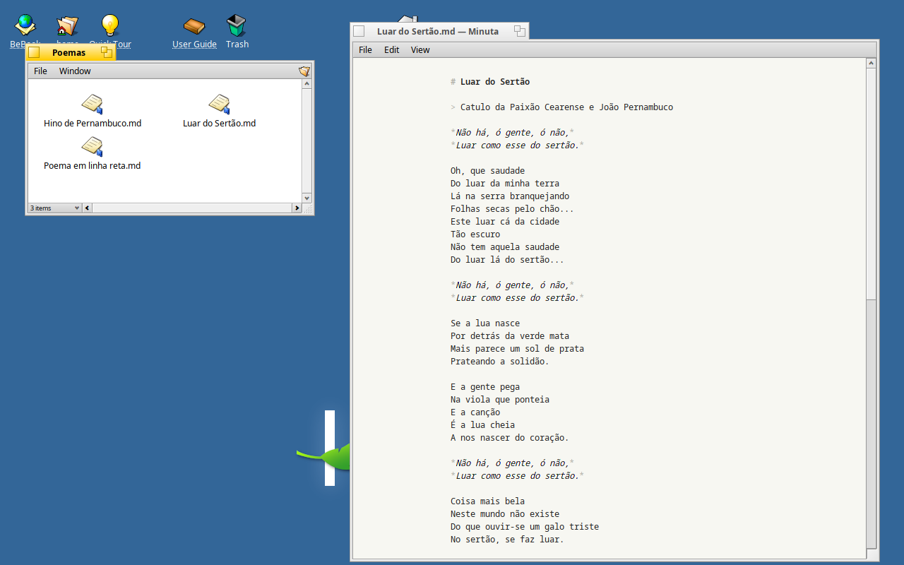

The texts in the screenshots are in `samples/`: "Poema em linha reta" by
Álvaro de Campos and the anthem of Pernambuco, both in the public domain.

## Download

Get the files from the
[releases page](https://github.com/breakzplatform/minuta/releases).

**Windows 98**

- `minuta-0.1.1-win98.zip` has `MINUTA.EXE`, `MD2HTMLW.EXE`, `README.TXT`
  and `LICENSE.TXT`. Unzip it into any folder and run `MINUTA.EXE`. There is
  nothing to install. Settings are saved in `MINUTA.INI` in the same folder.
- `minuta-0.1.1-setup.exe` installs the same files in Program Files, adds a
  Start menu entry and makes Minuta the program for `.md` and `.markdown`
  files, so double-clicking one opens it. If another program had `.md`
  before, the uninstaller gives it back; otherwise it removes the
  association.
- `minuta-0.1.1-dos.zip` has `MD2HTMLD.EXE`, which runs on plain DOS (the
  DOS/32A extender is built in).

Minuta runs on Windows 98 SE and should also run on Windows 98 and ME, which
I have not tested. It needs `RICHED20.DLL`, which Windows 98 SE includes.

**Haiku**

`minuta-0.1.1-1-x86_64.hpkg` is a Haiku package. Double-click it and click
Install in HaikuDepot, or run `pkgman install minuta-0.1.1-1-x86_64.hpkg`.
Minuta then appears in Deskbar under Applications, and a `minuta` command
opens files from Terminal. It runs on Haiku R1/beta6 and later, 64-bit.
[docs/haiku.md](docs/haiku.md) has more on installing and using it.

## Using Minuta

Open a file from the command line or with File > Open. Minuta reopens the
last file when you start it without one. On Haiku you can also double-click
Markdown files in Tracker or drop them on a Minuta window.

The shortcuts are the same on both systems, except that Haiku uses its
Command key (Alt, unless you changed it) where Windows uses Ctrl.

| Windows 98 | Haiku | Action |
|---|---|---|
| Ctrl+N, Ctrl+O | Alt+N, Alt+O | New, open |
| Ctrl+S, Ctrl+Shift+S | Alt+S, Alt+Shift+S | Save, save as |
| Ctrl+E | Alt+E, Alt+Shift+E | Export HTML, and open it in the browser if you like |
| Ctrl+R | Alt+R | Preview the rendered document; Esc goes back to the same place |
| Ctrl+Shift+F | Alt+Shift+F | Focus mode: fade everything but the current sentence |
| Ctrl+Shift+P | Alt+Shift+P | Focus on the whole paragraph instead |
| Ctrl+Shift+T | Alt+Shift+T | Typewriter scrolling: keep the caret line in the middle |
| Ctrl+Shift+N | Alt+Shift+N | Night theme |
| F11 | F11 or Alt+Enter | Full screen, without window frame or menu; Esc to leave |
| Ctrl+Shift+W | Alt+Shift+W | Word count, characters and reading time |
| Ctrl+F, F3 | Alt+F, Alt+G | Find, find next |
| Ctrl+H | | Replace (Windows only) |
| Ctrl+Z, Ctrl+Y | Alt+Z | Undo; redo on Windows |
| Ctrl+= and Ctrl+- | Alt+= and Alt+- | Larger or smaller text |
| Ctrl+] and Ctrl+[ | View > Column width | Wider or narrower column, from 50 to 80 characters |

### Files and encodings

Files that start with a UTF-8 byte order mark, or that are valid UTF-8, open
as UTF-8. Anything else opens as Windows-1252. Minuta saves a file in the
encoding it was read in and keeps its byte order mark and line endings. New
files are UTF-8, with CRLF line endings on Windows and LF on Haiku.

On Windows the editor works in Windows-1252, so characters outside it, such
as Greek, Japanese or emoji, appear as `?`. Lines you don't edit are written
back exactly as they were, so those characters survive a save. Save As lets
you pick UTF-8 or Windows-1252. The Haiku version works in UTF-8 and shows
every character.

On Windows, while a document has unsaved changes, Minuta writes a copy to
`name.md~` every 30 seconds and deletes it when you save or close. The
Haiku version has no autosave yet.

### Settings

On Windows, `MINUTA.INI` keeps the font (`Font`, `FontSize`), the column
width (`ColumnWidth`), the modes (`Night`, `Focus`, `FocusParagraph`,
`Typewriter`), the last file and the window position. `Trace=1` writes a
diagnostic log to `TRACE.TXT`. On Haiku the same choices are kept in
`~/config/settings/Minuta`.

### md2html

    MD2HTMLD [--codepage utf8|1252|850] [--out-codepage utf8|1252|850]
             [--full-html] [--gfm] [-o out.html] in.md

The DOS build reads code page 850 by default and the Win32 build reads 1252.
A file with a UTF-8 byte order mark is always read as UTF-8. The output is
UTF-8 unless you ask for another code page with `--out-codepage`; characters
that code page can't hold become `&#NNNN;` references. `--full-html` writes a
complete page with a `<meta http-equiv>` charset, which Internet Explorer 4
and 5 understand. The other options are md4c's; see `--help`.

## Building

**Windows 98 and DOS.** You need
[Open Watcom 2.0](https://github.com/open-watcom/open-watcom-v2), GNU make,
and clang for the tests; `make dist` also needs makensis 3 and zip. The
Makefile looks for Open Watcom in `~/vms/retro/toolchain/ow2` and builds on
an Apple Silicon Mac or on x86-64 Linux; set `WATCOM` to use another
location.

    make win    # build/bin/MINUTA.EXE and build/bin/MD2HTMLW.EXE
    make dos    # build/bin/MD2HTMLD.EXE
    make test   # unit tests and md2html tests, built natively
    make dist   # the release ZIPs in build/dist

**Haiku.** On Haiku, with the development tools the installer includes
(gcc, make and the system headers):

    make -C src/haiku            # src/haiku/objects/Minuta
    make -C src/haiku install    # into ~/config/non-packaged, with a `minuta` command
    make -C src/haiku package    # src/haiku/objects/minuta-0.1.1-1-x86_64.hpkg

The code in `src/core` is plain C and is tested on the host with
`make test`. `src/win` is the Windows program, `src/haiku` the Haiku one and
`src/cli` is md2html. `tests/vm` has the scripts that drive the Windows 98,
FreeDOS and MS-DOS 6.22 virtual machines, and `tools/haiku-vm` and
`tests/haiku` do the same for a Haiku virtual machine; they were used to
test the programs and take these screenshots. The icons are drawn by
`tools/icons/win98.py` (pixel grids for `res/*.ICO`) and
`tools/icons/haiku.py` (vector icons for `src/haiku/Icons.rdef`). The
Markdown parser is md4c 0.6.0, in `vendor/md4c`.

## Samples

`samples/` has Markdown files for trying Minuta and for the tests. The
literary ones are in the public domain in Brazil:

- *Hino de Pernambuco*, the state anthem, with lyrics by Oscar Brandão da
  Rocha and music by Nicolino Milano. Official texts are not covered by
  copyright in Brazil (Law 9.610/1998, art. 8).
- *Poema em linha reta* by Álvaro de Campos, a heteronym of Fernando
  Pessoa, who died in 1935.
- *Luar do Sertão* (1914), with lyrics by Catulo da Paixão Cearense, who
  died in 1946. The melody is also credited to João Pernambuco, who died in
  1947; Catulo claimed the song as his alone, and who wrote the tune is
  still disputed.

The anthem and the poem come from Wikisource and *Luar do Sertão* from
Blocos Online. Each sample has 8.3 copies in Windows-1252 and code page 850
for Windows 98 and DOS (`HINOPE.MD`, `POEMA.MD`, `LUAR.MD` and the `*850.MD`
files); `tools/dos-samples.sh` rebuilds them from the originals.

## Why?

Why not?

## License

GPL-3.0-only with additional terms, see [LICENSE](LICENSE) and [NOTICE](NOTICE). md4c is also under the MIT license, in
`vendor/md4c/LICENSE.md`.
