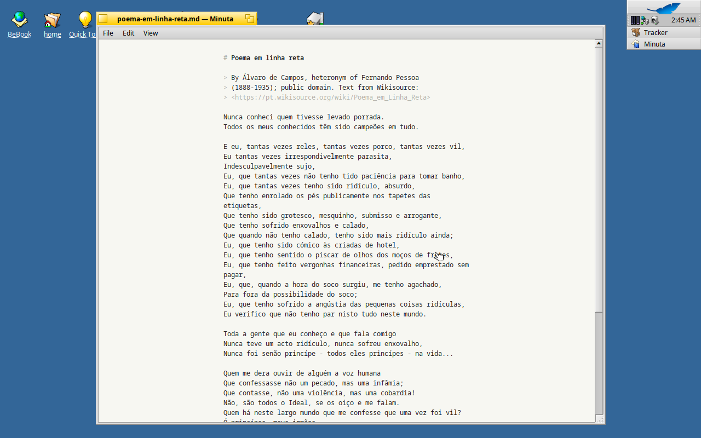

# Minuta

Minimal Markdown editor for Windows 98 SE, plus `md2html` for Win32 and DOS.
See `SPEC.md` for the design and `docs/STATUS.md` for progress.

## Build

Requires Open Watcom 2.0 (defaults to `~/vms/retro/toolchain/ow2`; override
with `WATCOM=...`) and clang for the native tests.

    make win    # build/bin/MINUTA.EXE, build/bin/MD2HTMLW.EXE
    make dos    # build/bin/MD2HTMLD.EXE
    make test   # native unit tests and md2html regression tests

## Haiku

Minuta also runs natively on Haiku (R1/beta6 or later). The Haiku version
lives in `src/haiku/` and shares the Markdown code with the Windows build.
It has the same features, plus a full screen mode (Alt+Enter or F11). Where
Windows uses Ctrl, Haiku uses Alt.

To build it on Haiku:

    make -C src/haiku            # builds src/haiku/objects/Minuta
    make -C src/haiku install    # installs it and adds a `minuta` command

## License

GPL-3.0-only with additional terms, see [LICENSE](LICENSE) and [NOTICE](NOTICE). Vendored md4c keeps its own MIT license in
`vendor/md4c/LICENSE.md`.
