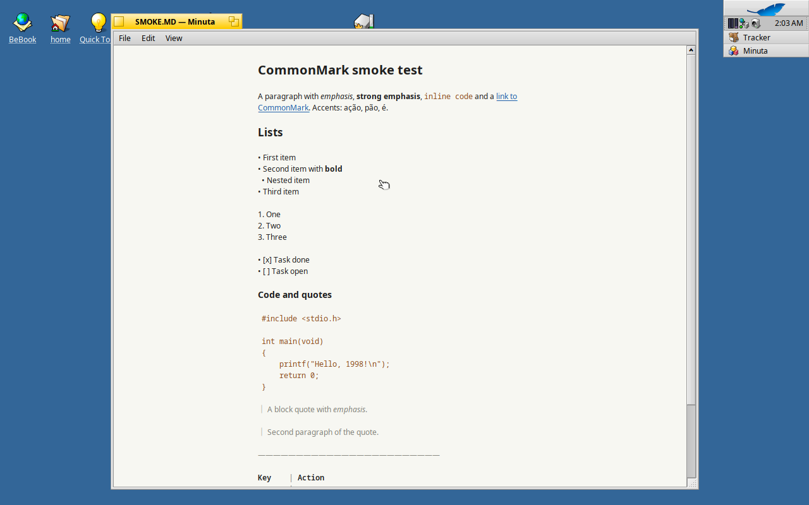
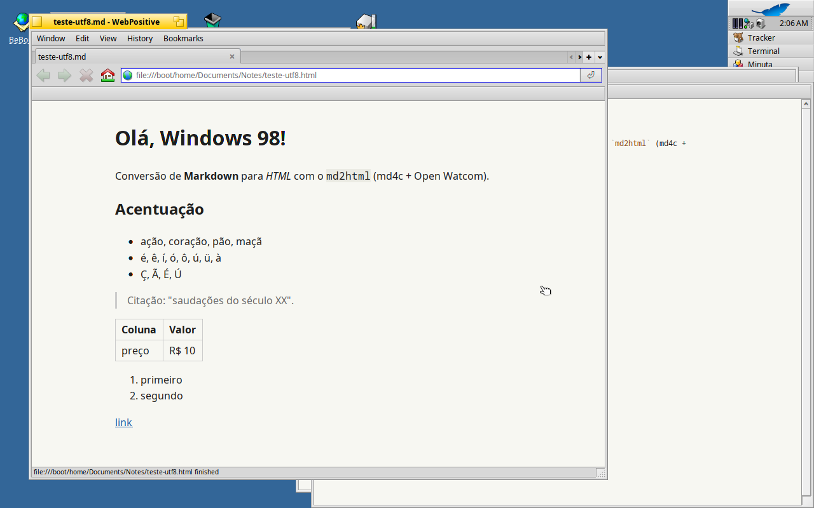

# Minuta

Minimal Markdown editor for Windows 98 SE, plus `md2html` for Win32 and DOS.
See `SPEC.md` for the design and `docs/STATUS.md` for progress.

## Build

Requires Open Watcom 2.0 (defaults to `~/vms/retro/toolchain/ow2`; override
with `WATCOM=...`) and clang for the native tests.

    make win    # build/bin/MINUTA.EXE, build/bin/MD2HTMLW.EXE
    make dos    # build/bin/MD2HTMLD.EXE
    make test   # native unit tests and md2html regression tests

## Haiku

A native Haiku port lives in `src/haiku/` (C++ on the BeAPI, sharing
`src/core/` and md4c with the Windows build). It is the same editor: a
`BTextView` with a centered 64-column text in the system fixed font (Noto
Sans Mono 12 pt), Markdown syntax dimmed as you type, focus mode, typewriter
scrolling, a night theme, a preview without an HTML engine, HTML export,
word count and find. Design: [SPEC-HAIKU.md](SPEC-HAIKU.md); status and test
evidence: [docs/STATUS-HAIKU.md](docs/STATUS-HAIKU.md).

| | |
|---|---|
|  |  |
|  |  |

### Building on Haiku

Needs the development tools the Haiku installer offers by default (gcc,
make and the system headers). From the repository root:

    make -C src/haiku            # src/haiku/objects/Minuta
    make -C src/haiku install    # ~/config/non-packaged/apps/Minuta and a `minuta` command

The build uses `-Wall -Wextra` and is free of warnings with Haiku R1/beta6's
gcc 13. From a Mac, `tools/haiku-vm/` runs a Haiku VM under QEMU and
`tools/haiku-vm/build` syncs the sources and builds there (see its README).

### Using Minuta on Haiku

Open files from Tracker (double-click, or drop them on a Minuta window),
from Terminal (`minuta notes.md`), or with File > Open. Shortcuts use the
Haiku command key (Alt by default) where Windows uses Ctrl:

| Keys | Action |
|---|---|
| Alt+N, Alt+O, Alt+S, Alt+Shift+S, Alt+W | New, Open, Save, Save as, Close |
| Alt+E, Alt+Shift+E | Export HTML; export and open it in the browser |
| Alt+R | Preview; Esc or Alt+R returns to the same place |
| Alt+Shift+F | Focus mode: everything but the current sentence is faded |
| Alt+Shift+P | Focus on the current paragraph instead of the sentence |
| Alt+Shift+T | Typewriter scrolling: the caret line stays in the middle |
| Alt+Shift+N | Night theme |
| Alt+Shift+W | Word count, characters and reading time |
| Alt+F, Alt+G, Alt+Shift+G | Find, find next, find previous |
| Alt+Z | Undo |
| Alt++, Alt+- | Larger or smaller text; View > Column width sets 50 to 80 characters |

- Files are read as UTF-8 (with or without a BOM) or, when they aren't
  valid UTF-8, as Windows-1252. Saving keeps the encoding, the BOM and the
  line endings; new files are UTF-8 with LF line endings.
- Haiku types most `.md` files as `text/plain`. When Minuta saves a file
  named `.md` or `.markdown` that is untyped or `text/plain`, it sets
  `text/markdown`, and on first launch it registers itself as the preferred
  application for `text/markdown` if none is set, so those files open in
  Minuta from Tracker.
- Settings (window frame, text size, column width, theme, focus and
  typewriter modes, last file) are kept in `~/config/settings/Minuta`.
- Differences from the Windows build: `BTextView` has no per-run
  background, so code is shown in its own color instead of on a shaded
  background, and it has no line spacing setting; there is no autosave and
  no replace.

## License

GPL-3.0-only with additional terms, see [LICENSE](LICENSE) and [NOTICE](NOTICE). Vendored md4c keeps its own MIT license in
`vendor/md4c/LICENSE.md`.
