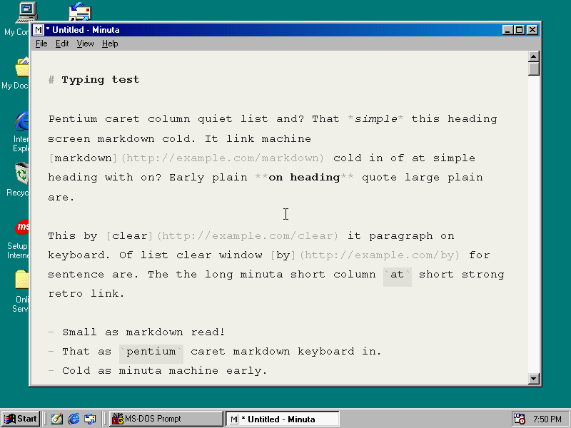
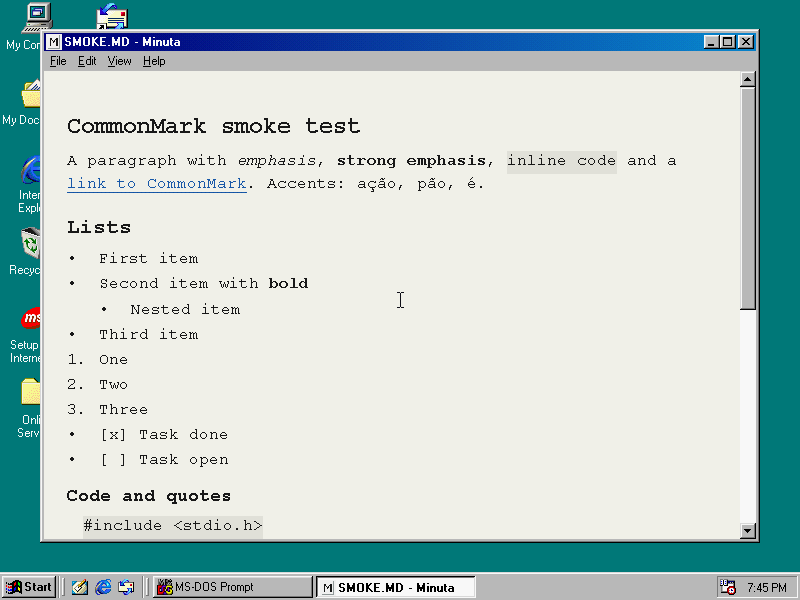
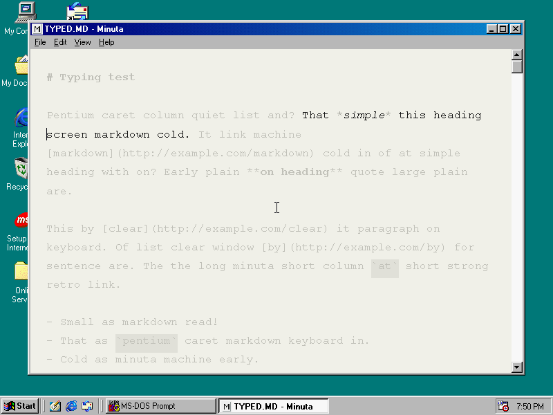
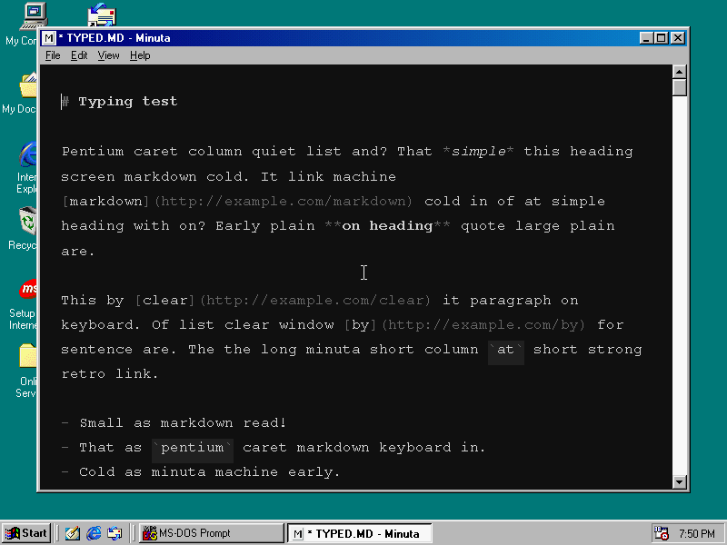
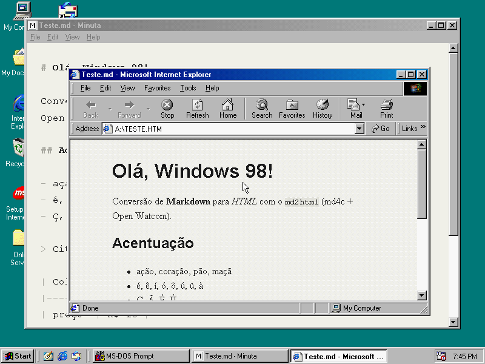

# Minuta

A minimal Markdown editor for Windows 98 SE, in the spirit of iA Writer: one
centered column of monospace text, Markdown syntax kept visible but dimmed,
focus mode, typewriter scrolling and a night theme. It comes with `md2html`,
a Markdown to HTML converter for the Win32 console and for DOS.

| | |
|---|---|
|  |  |
|  |  |

- `MINUTA.EXE`: Win32 GUI for Windows 98 SE (also 98 FE and ME), about
  200 KB, no runtime DLLs. It imports KERNEL32, USER32, GDI32 and COMDLG32
  and loads RICHED20.DLL (RichEdit 2.0) and, for "open in browser",
  SHELL32 at run time.
- `MD2HTMLW.EXE` (Win32 console) and `MD2HTMLD.EXE` (DOS, DOS/32A extender
  built in): [md4c](https://github.com/mity/md4c)'s `md2html` with code page
  options.

Status and test evidence for each milestone: [docs/STATUS.md](docs/STATUS.md).
Design: [SPEC.md](SPEC.md).

## Using Minuta

Open a file by passing it on the command line, with File > Open, or let
Minuta reopen the last file. Everything is on the keyboard:

| Keys | Action |
|---|---|
| Ctrl+N, Ctrl+O, Ctrl+S, Ctrl+Shift+S | New, Open, Save, Save As |
| Ctrl+E | Export HTML (and optionally open it in the browser) |
| Ctrl+R | Preview the rendered document; Esc or Ctrl+R returns to the same place |
| Ctrl+Shift+F | Focus mode: everything but the current sentence is faded |
| Ctrl+Shift+P | Focus on the current paragraph instead of the sentence |
| Ctrl+Shift+T | Typewriter scrolling: the caret line stays in the middle |
| Ctrl+Shift+N | Night theme |
| F11 | Full screen: no window frame, menu or taskbar; F11 or Esc to leave |
| Ctrl+Shift+W | Word count, characters and reading time |
| Ctrl+F, F3, Ctrl+H | Find, find next, replace |
| Ctrl+Z, Ctrl+Y | Undo (word by word), redo |
| Ctrl+=, Ctrl+- | Larger or smaller text |
| Ctrl+], Ctrl+[ | Wider or narrower column (50 to 80 characters) |

### Files and encodings

- A file with a UTF-8 BOM, or that is valid UTF-8, is read as UTF-8;
  anything else as Windows-1252. New files are UTF-8 with CRLF line endings.
- Saving keeps the file's encoding, BOM and line endings. Save As can switch
  between UTF-8 and Windows-1252 with the "Save as type" list.
- The editor works in Windows-1252, so characters outside it (Greek, CJK,
  emoji...) show as `?`. Lines you don't edit are written back byte for
  byte, so those characters survive a save; a line you edit keeps what you
  see.
- While a document has unsaved changes, a copy is written to `name.md~`
  every 30 seconds. Saving or closing removes it.

### Settings

`MINUTA.INI`, beside `MINUTA.EXE`, section `[Minuta]`:

| Key | Default | |
|---|---|---|
| `Font`, `FontSize` | `Courier New`, `12` | View > Font; 8 to 28 points |
| `ColumnWidth` | `64` | characters, 50 to 80 |
| `Night`, `Focus`, `FocusParagraph`, `Typewriter` | `0` | modes |
| `LastFile`, `WindowLeft`... `Maximized` | | restored on start |
| `Trace` | `0` | `1` writes `TRACE.TXT` beside the exe (diagnostics) |

### md2html

    MD2HTMLD [--codepage utf8|1252|850] [--out-codepage utf8|1252|850]
             [--full-html] [--gfm] [-o out.html] in.md

The input code page defaults to 850 in the DOS build and 1252 in the Win32
build; a UTF-8 BOM always means UTF-8. Output is UTF-8 unless
`--out-codepage` says otherwise; characters the output code page can't hold
become `&#NNNN;` references. `--full-html` declares the charset with
`<meta http-equiv="Content-Type">`, which IE 4 and 5 understand. All other
options are md4c's (`--help`).

## Building

Requirements: [Open Watcom 2.0](https://github.com/open-watcom/open-watcom-v2)
(the Makefile expects it in `~/vms/retro/toolchain/ow2`; pass `WATCOM=...`
to use another place), GNU make and clang for the native tests.

    make win    # build/bin/MINUTA.EXE and build/bin/MD2HTMLW.EXE
    make dos    # build/bin/MD2HTMLD.EXE
    make test   # core unit tests and md2html regression tests, natively

`src/` builds at Watcom warning level 4 with warnings as errors, and
natively with `-Wall -Wextra -Wpedantic -Werror`.

## Layout

- `src/core/`: portable C, unit-tested on the Mac: encodings, the document
  codec (encoding detection, line endings, byte preservation), the per-line
  Markdown span scanner behind the dimming, the md4c to RTF renderer of the
  preview, HTML export, word counts.
- `src/win/`: the Win32 program: window and menus (`main.c`), the RichEdit
  editor and edit tracking (`editor.c`), styling, focus and typewriter
  (`style.c`, through the Text Object Model in `tom.c`), undo (`undo.c`),
  preview, export, word count and find (`preview.c`, `commands.c`), files and
  settings.
- `src/cli/`: `md2html`.
- `vendor/md4c/`: md4c 0.6.0 with a small patch for Open Watcom.
- `tests/unit/`: core unit tests. `tests/cli/`: md2html tests.
  `tests/vm/`: acceptance scripts that drive the Windows 98, FreeDOS and
  MS-DOS 6.22 virtual machines of `~/vms/retro` and take the screenshots in
  `docs/shots/`. `tests/win/`: RichEdit probes used to find out how
  Windows 98's RICHED20.DLL behaves.

## Notes on RichEdit 2.0 (Windows 98)

Found with the probes in `tests/win/` and the traces:

- Formatting changes enter RichEdit's undo stack, so styling would make
  Ctrl+Z undo colors. Minuta turns RichEdit's undo off and keeps its own.
- Formatting through `EM_EXSETSEL` + `EM_SETCHARFORMAT` moves the selection
  and scrolls; restoring the view with `EM_LINESCROLL` jumped to the top of a
  1 MB document. Styling goes through TOM ranges instead, which leave the
  selection and the view alone. `ITextDocument::Freeze` is not implemented
  in 2.0; `WM_SETREDRAW` is used.
- Giving a paragraph format to a whole 1 MB document makes RichEdit lay out
  every line at once (seconds). Line spacing is therefore set paragraph by
  paragraph, as paragraphs get styled.
- `EM_POSFROMCHAR` returns 0,0 and `EM_GETSCROLLPOS` doesn't exist.
- The Windows 98 caption font has no glyph for `•` and `—`, so the title bar
  says `name - Minuta` and `* name - Minuta` when modified.

## License

Minuta is released under the GNU GPL version 3 only, copyright (c) 2026 Joselito
Junior; see [LICENSE](LICENSE). The vendored md4c keeps its own MIT license
in `vendor/md4c/LICENSE.md`.
